# Web Recycle — Sistema de Gestão para Reciclagem

Sistema web de gestão para empresa de compra e venda de materiais recicláveis.
A empresa **compra** material de catadores, cooperativas e sucateiros, o material
**entra no estoque**, e depois é **vendido** à indústria recicladora, **saindo do
estoque**. Sobre essa base, o sistema oferece controle de estoque com trilha de
movimentação, análise de margem por material e controle de contas a pagar.

Desenvolvido como Trabalho de Conclusão de Curso em Análise e Desenvolvimento de
Sistemas.

---

## ⚠️ Antes de tudo: a nomenclatura é invertida

Esta é a convenção mais importante do sistema, e ela contraria o uso comum:

| Termo | Neste sistema | No uso comum |
|---|---|---|
| **`cliente`** | quem **vende** material **para** a empresa — catador, cooperativa, sucateiro | quem compra |
| **`fornecedor`** | quem **compra** material **da** empresa — indústria recicladora | quem vende |

A razão é a perspectiva do operador: ele atende o cliente no balcão da balança.
Toda a modelagem do banco, os nomes das tabelas e as telas seguem essa convenção.
Quem ler o código esperando o significado usual vai interpretar o fluxo ao
contrário.

Uma consequência disso: **compra e venda são a mesma transação vista de dois
lados**. O que o sistema chama de "compra" é a entrada de material; o que chama de
"venda" é a saída.

---

## Arquitetura

O sistema tem dois componentes:

```
    NAVEGADOR
        │  HTTP
        ▼
┌───────────────────┐        ┌──────────────────┐
│  APLICAÇÃO PHP    │  PDO   │   PostgreSQL     │
│  Apache (XAMPP)   │───────▶│  schema          │
│  PHP 8.2          │        │  'reciclagem'    │
└───────────────────┘        └──────────────────┘
```

A aplicação é PHP puro, **sem framework**, com roteamento próprio. O front-end usa
Bootstrap 5.3, jQuery, DataTables e Select2. As dependências de servidor são
gerenciadas pelo Composer: PHPMailer (envio de comprovante), Dompdf (geração de
PDF), PhpSpreadsheet (importação e exportação de planilhas) e phpdotenv
(configuração).

> O agente que conversa com a balança é um programa à parte, que vive em outro
> repositório e **não faz parte desta instalação**. O sistema funciona sem ele:
> o peso é digitado à mão. Quando o agente está no ar, as telas de compra e de
> venda passam a exibir a leitura automática.

---

## Pré-requisitos

| Item | Versão | Observação |
|---|---|---|
| PHP | 8.2 ou superior | o XAMPP 8.2.x já traz |
| Apache | 2.4 | com `mod_rewrite` habilitado |
| PostgreSQL | 14 ou superior | |
| Composer | 2.x | <https://getcomposer.org/download/> |

### Extensões do PHP

Abra `C:\xampp\php\php.ini` e confira se estas linhas existem **sem o ponto e
vírgula** na frente:

```ini
extension=pdo_pgsql
extension=pgsql
extension=mbstring
extension=zip
extension=gd
extension=fileinfo
extension=openssl
```

No XAMPP, `pdo_pgsql` e `pgsql` costumam vir comentadas — são justamente as duas
indispensáveis. Depois de descomentar, **reinicie o Apache**.

Algumas instalações do XAMPP declaram o OpenSSL na forma
`extension=php_openssl.dll`, em outra linha do arquivo. Se já houver uma assim
ativa, deixe a linha `;extension=openssl` como está: habilitar as duas faz o PHP
reclamar que o módulo já foi carregado.

Para que serve cada uma:

- `pdo_pgsql` e `pgsql` — conexão com o banco. Sem elas o sistema não abre.
- `mbstring` e `fileinfo` — exigidas pelo Dompdf e pelo PhpSpreadsheet.
- `zip` — leitura e escrita de `.xlsx` na importação e na exportação de vendas.
- `gd` — imagens nos PDFs e redimensionamento da foto de perfil.
- `openssl` — envio de e-mail por SMTP com TLS.

Confira o resultado com:

```bash
php -m
```

---

## Instalação

### 1. Clonar o projeto

```bash
cd C:\xampp\htdocs
git clone <url-do-repositorio> web-recycle
cd web-recycle
```

O nome da pasta importa: ele entra na URL e precisa bater com o `URL_BASE` do
passo 4. Se usar outro nome, ajuste lá.

### 2. Instalar as dependências

```bash
composer install
```

Use `install`, **não** `update`. O `composer.lock` está versionado e fixa as
versões testadas; `update` as ignora e pode trazer versões diferentes.

### 3. Criar o banco de dados

O passo a passo completo — criação do banco, ordem das migrations e dados de
referência — está em **[`sql/README.md`](sql/README.md)**. Em resumo:

```bash
createdb reciclagem

# 1. estrutura (ponto zero)
psql -d reciclagem -v ON_ERROR_STOP=1 -f sql/0000_baseline_schema.sql

# 2. migrations posteriores à baseline, em ordem cronológica
psql -d reciclagem -v ON_ERROR_STOP=1 -f sql/2026-10-14_padronizar_nomenclatura.sql
psql -d reciclagem -v ON_ERROR_STOP=1 -f sql/2026-10-14_endereco_unico_e_documento.sql
psql -d reciclagem -v ON_ERROR_STOP=1 -f sql/2026-10-14_remove_colunas_sem_uso.sql

# 3. dados de referência e usuário administrador
psql -d reciclagem -v ON_ERROR_STOP=1 -f sql/0001_seed_inicial.sql
```

A ordem importa: o seed usa os nomes já padronizados, então é o **último** passo.
Ao final você terá 19 tabelas no schema `reciclagem`.

### 4. Configurar o `.env`

```bash
copy .env.example .env
```

E preencha:

```ini
APP_NAME=Nome da Sua Empresa
URL_BASE=http://localhost/web-recycle

DB_HOST=127.0.0.1
DB_PORT=5432
DB_NAME=reciclagem
DB_USER=postgres
DB_PASS=sua_senha
```

Três pontos de atenção:

- **`URL_BASE` sem a barra no fim.** Todo redirecionamento e todo caminho de
  imagem do sistema é montado a partir dessa variável. Se ela estiver errada, as
  telas abrem mas os redirecionamentos levam a lugar nenhum.
- **`APP_NAME` não pode ficar vazio.** Ele identifica a empresa no menu, no
  comprovante de compra e na planilha de exportação — e a exportação falha com
  mensagem explícita se o campo estiver em branco.
- **O bloco `MAIL_*` é opcional.** Sem ele o sistema funciona normalmente; apenas
  o envio de comprovante por e-mail deixa de funcionar.

### 5. Habilitar o `mod_rewrite` no Apache

O sistema usa URLs amigáveis (`/compras/listar` em vez de
`index2.php?pagina=compras/listar`). Isso depende do `.htaccess`, que só é lido se
o Apache permitir.

Em `C:\xampp\apache\conf\httpd.conf`, confira se a linha do módulo está
descomentada:

```apache
LoadModule rewrite_module modules/mod_rewrite.so
```

E se o diretório do projeto permite sobrescrita. Procure o bloco
`<Directory "C:/xampp/htdocs">` e garanta:

```apache
AllowOverride All
```

Se estiver `AllowOverride None`, o `.htaccess` é ignorado em silêncio: nenhuma
mensagem de erro aparece, mas **toda rota cai na página inicial**. É o sintoma
mais comum de instalação.

Reinicie o Apache depois de alterar.

### 6. Permissão de escrita em duas pastas

O sistema grava arquivos em:

- `images/user/` — fotos de perfil dos usuários
- `uploads/comprovantes_venda/` — comprovantes enviados pelos parceiros

No Windows com XAMPP isso normalmente já funciona. Em Linux:

```bash
chmod -R 775 images/user uploads/comprovantes_venda
```

### 7. Primeiro acesso

Abra <http://localhost/web-recycle/views/user/login.php> e entre com:

| | |
|---|---|
| e-mail | `admin@reciclagem.local` |
| senha | `admin@123` |

O sistema **exige a troca da senha neste primeiro acesso**. Veja a seção seguinte.

---

## Como usar o sistema

> **Os dados que aparecem nas telas desta seção são de demonstração** — as
> empresas, os documentos, os telefones, os valores e as movimentações foram
> gerados para teste, e nenhum cliente ou fornecedor real está representado.
> A exceção é o nome do autor, que aparece como usuário logado e também como
> cliente e fornecedor de teste. E-mails e telefones estão cobertos nas capturas.

### 1. Login

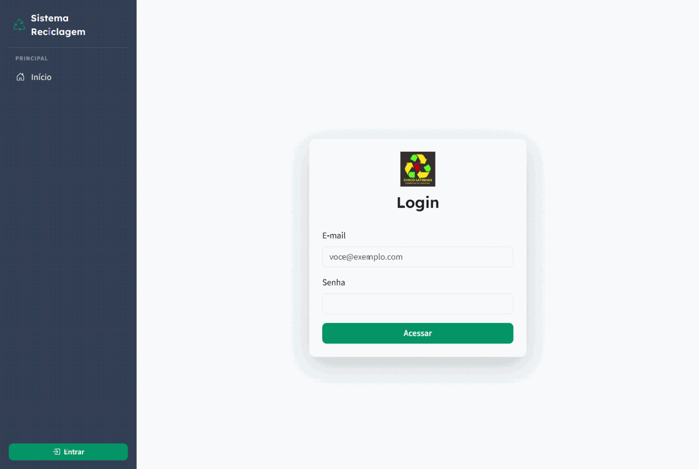

O acesso é por e-mail e senha. A sessão é verificada a cada requisição pelo
roteador — digitar a URL de uma tela interna sem estar logado leva de volta para
cá.

> **A raiz do projeto não é o sistema.** `http://localhost/web-recycle/` abre o
> `index.php`, uma landing page institucional antiga que sobrou do início do
> projeto. O sistema propriamente dito está nas rotas, servidas pelo `index2.php`.

### 2. Troca de senha obrigatória

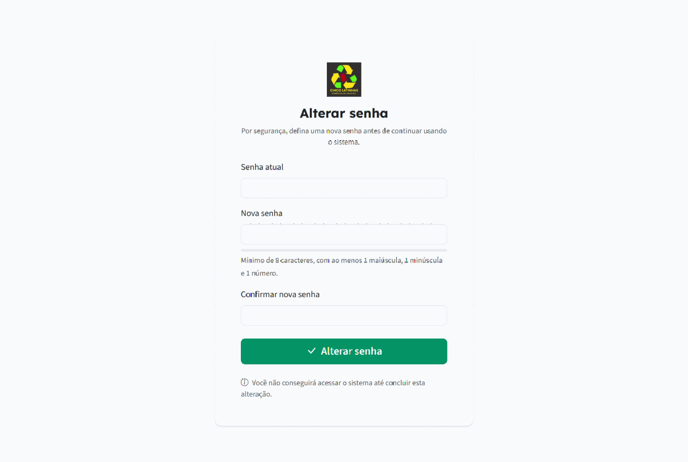

Todo usuário criado pelo administrador nasce com a coluna
`usuario.precisa_alterar_senha` em `1`. Enquanto ela não for zerada, **o roteador
intercepta qualquer rota** e devolve o usuário para esta tela. Não há como navegar
no sistema antes de trocar a senha — inclusive na conta `admin@reciclagem.local`
criada pelo seed.

A mesma regra vale quando o administrador usa o botão **Resetar senha** na tela de
usuários: a conta volta a exigir a troca no acesso seguinte.

### 3. Painel inicial

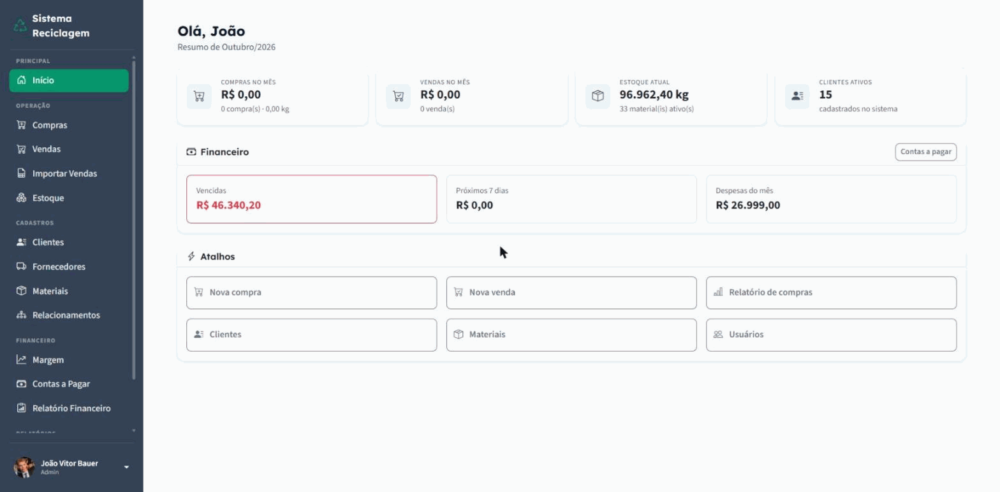

Consolida o mês corrente: compras, vendas, estoque atual e clientes ativos, mais o
bloco financeiro com o que está vencido, o que vence nos próximos sete dias e as
despesas do mês. Os atalhos abaixo levam direto às ações mais frequentes.

### 4. Cadastros

Antes de registrar qualquer operação é preciso ter cadastrado **material** e a
contraparte. Lembrando a convenção invertida:

**Clientes — de quem a empresa compra.**

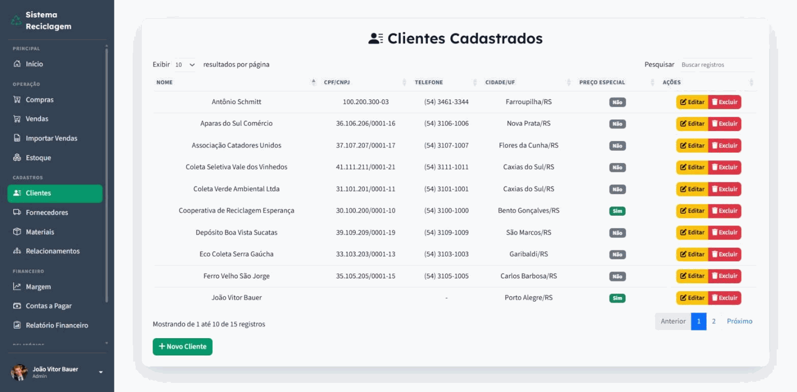

A coluna **Preço especial** marca os clientes que têm tabela de preço própria; na
compra, o operador escolhe se aplica o preço normal ou o especial.

**Fornecedores — para quem a empresa vende.**

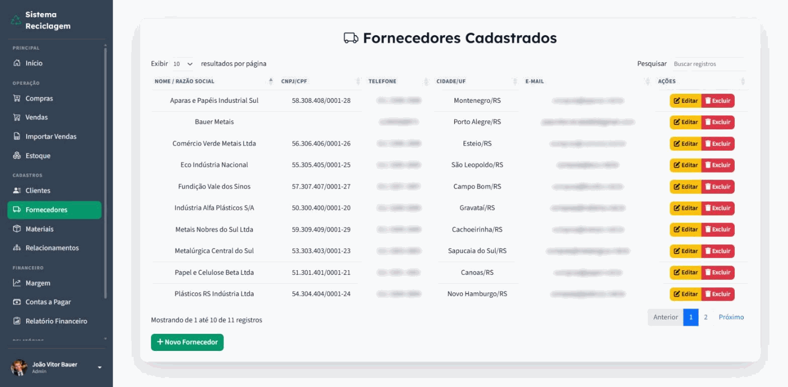

**Materiais — o catálogo e os preços.**

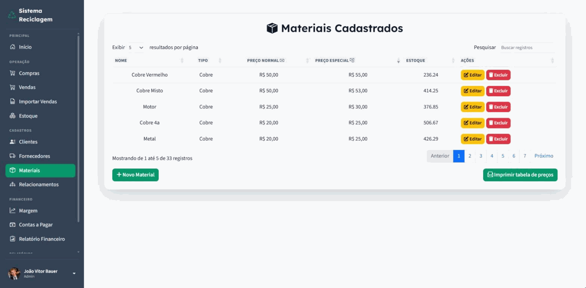

Cada material tem preço normal, preço especial, tipo e o saldo em estoque. O preço
cadastrado aqui é a base de toda pesagem e de todo o cálculo de margem, por isso
cadastrar e editar material é restrito ao perfil Admin — consultar a lista é
liberado para todos. O botão **Imprimir tabela de preços** gera um PDF para
afixar no balcão.

### 5. Compra — entrada de material

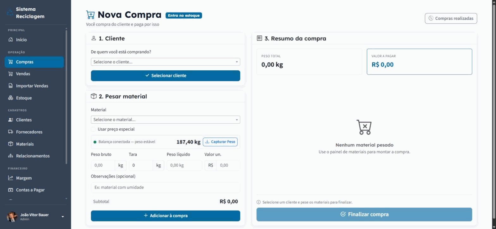

A tela é montada em três blocos, na ordem em que o atendimento acontece:

1. **Cliente** — de quem se está comprando.
2. **Pesar material** — escolhe o material, informa peso bruto e tara; o peso
   líquido e o subtotal são calculados. Cada material pesado vira um item.
3. **Resumo da compra** — acumula os itens e fecha a operação.

**A faixa com a leitura da balança** — na captura acima, "Balança conectada —
peso estável", com o valor e o botão *Capturar Peso* — só aparece quando o
agente da balança está rodando. Com ele no ar, o operador confere o número no
visor e traz o peso para o formulário com um clique. **Sem o agente, a faixa não
é exibida** e o campo de peso é preenchido manualmente; o resto da tela funciona
igual.

Ao finalizar, o sistema grava a compra, **dá entrada no estoque** de cada material
e registra a movimentação. O comprovante pode ser impresso em PDF ou enviado por
e-mail ao cliente.

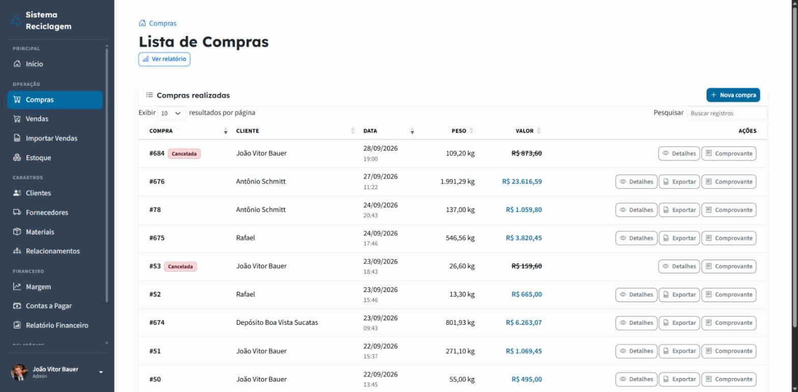

Na lista, cada compra oferece **Detalhes**, **Exportar** (gera a planilha que o
parceiro usa para importar a venda do lado dele) e **Comprovante**. Compras
canceladas aparecem com o selo `Cancelada` e o valor riscado — o cancelamento
estorna o estoque e tira os valores das somas do período, por isso é restrito ao
Admin.

### 6. Venda — saída de material

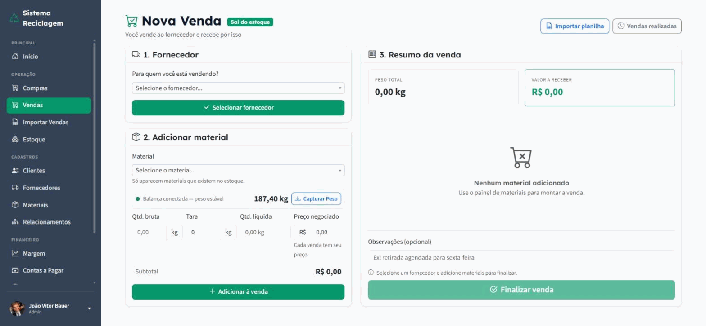

Simétrica à compra, com duas diferenças importantes:

- **Só aparecem materiais que existem no estoque.** Não se vende o que não entrou.
- **O preço é negociado por venda**, não vem do cadastro. O preço do material é
  preço de compra; a venda à indústria é negociada caso a caso, e é dessa
  diferença que sai a margem.

A leitura da balança funciona aqui como na compra: a faixa aparece quando o
agente está rodando e some quando não está, caso em que a quantidade é digitada.

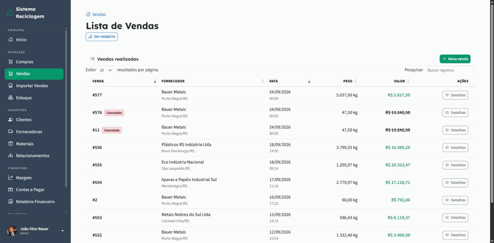

**Importação por planilha.** Quando o parceiro manda a nota em planilha, a venda
pode ser lançada a partir dela, em três passos:

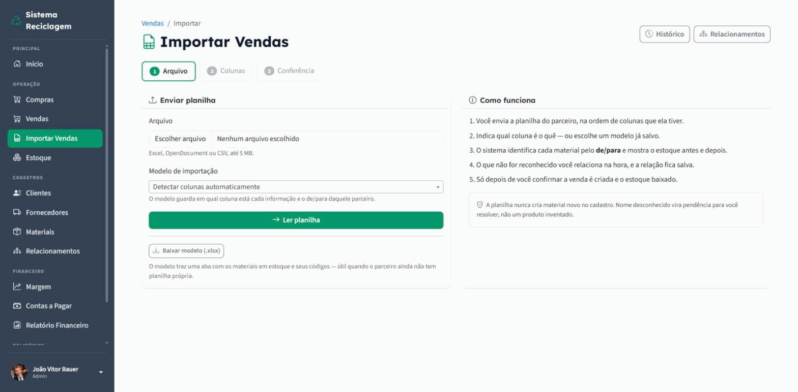

O sistema identifica cada material por um de/para que fica salvo para as próximas
importações. O que não for reconhecido vira pendência para o usuário resolver na
hora — a planilha **nunca cria material novo** no cadastro.

### 7. Estoque

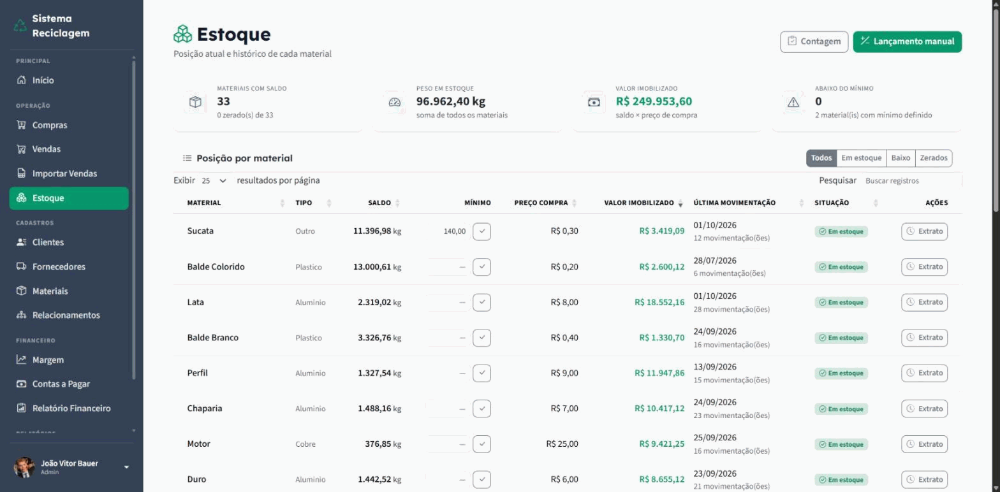

A posição de cada material, com saldo, valor imobilizado e data da última
movimentação. O saldo **não é digitado**: ele é consequência das compras e das
vendas. As duas únicas formas de alterá-lo à mão são a **Contagem** (inventário) e
o **Lançamento manual**, ambas restritas ao Admin e ambas registradas no extrato,
que guarda o histórico completo de entradas e saídas de cada material.

O **mínimo** por material é opcional; definido, o painel passa a sinalizar quando
o saldo cai abaixo dele.

### 8. Relatórios

**Relatório de compras** — filtra por período, cliente, material e tipo, com
totais e exportação em PDF.

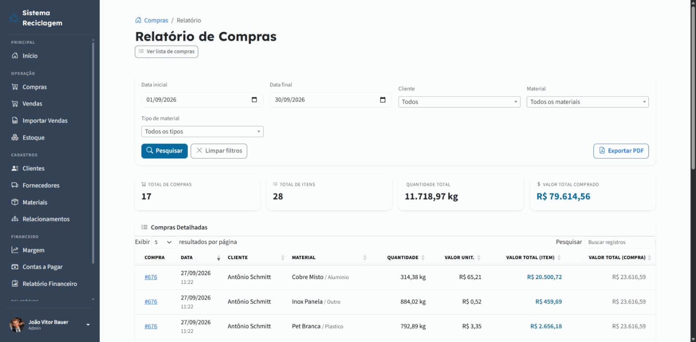

**Margem por material** — o relatório mais importante do sistema. Confronta a
receita das vendas com o custo do que foi vendido e mostra a margem bruta no
período, destacando os materiais com margem comprimida ou negativa e o estoque
parado.

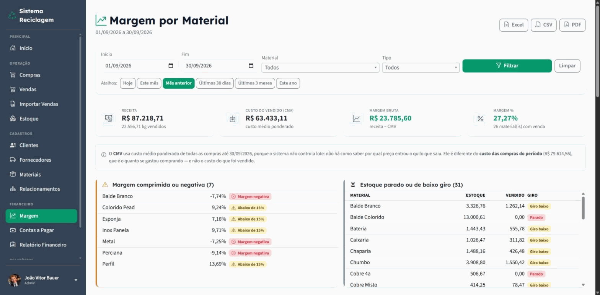

> O custo usa **custo médio ponderado** de todas as compras até a data final,
> porque o sistema não controla lote: não há como saber por qual preço entrou o
> quilo que saiu. Esse número é diferente do custo das compras do período, que é
> quanto se gastou comprando — e não o custo do que foi vendido. O próprio
> relatório traz esse aviso em tela.

**Contas a pagar** — as despesas e seus vencimentos, com categoria, centro de
custo e parcelamento.

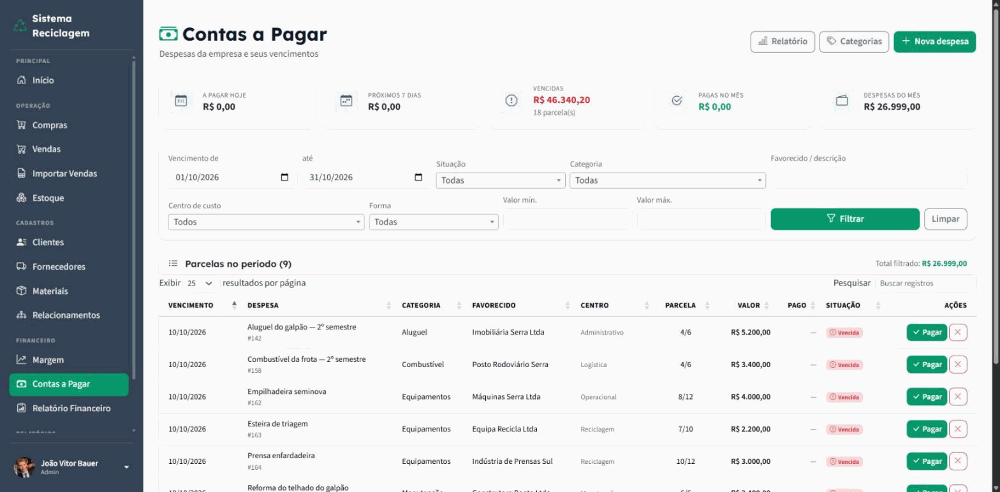

### 9. Perfis de acesso

O sistema tem dois perfis, gravados em `usuario.permissao`:

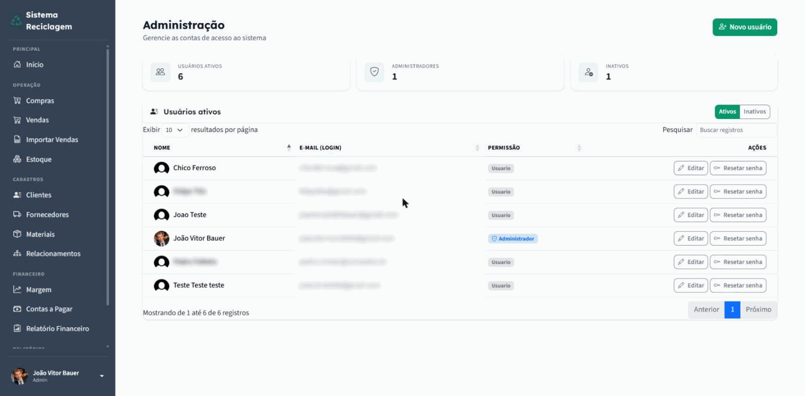

| | **Admin** | **Usuario** |
|---|---|---|
| Registrar compra e venda | ✅ | ✅ |
| Consultar materiais, clientes, fornecedores | ✅ | ✅ |
| Consultar estoque e extrato | ✅ | ✅ |
| Cadastrar e editar material, cliente, fornecedor | ✅ | ❌ |
| Cancelar compra ou venda | ✅ | ❌ |
| Ajustar estoque e registrar inventário | ✅ | ❌ |
| Importar venda por planilha | ✅ | ❌ |
| Gerenciar o de/para de materiais | ✅ | ❌ |
| Todo o módulo Financeiro (margem, contas, categorias) | ✅ | ❌ |
| Criar usuário e resetar senha | ✅ | ❌ |

A lógica por trás da divisão: o perfil **Usuario** opera o balcão — pesa, registra,
consulta. O perfil **Admin** controla o que define dinheiro (preço, cancelamento,
saldo de estoque) e o que expõe o resultado da empresa (margem, despesas).

A checagem é de servidor e acontece em dois níveis, descritos na seção
[Perfis e permissões](#perfis-e-permissões).

---

## Banco de dados

PostgreSQL, schema **`reciclagem`** — 19 tabelas. O `banco.php` aplica
`SET search_path TO reciclagem` a cada conexão, então as consultas no código usam
o nome simples da tabela.

### Acesso e auditoria

| Tabela | O que guarda |
|---|---|
| `usuario` | contas de acesso: nome, e-mail, hash da senha, perfil (`Admin`/`Usuario`), foto, status e o sinalizador `precisa_alterar_senha` |
| `endereco` | endereço de qualquer entidade do sistema — usuário, cliente ou fornecedor — numa tabela só, identificada por tipo e id da entidade |
| `registro_movimento` | log de auditoria: quem fez o quê e quando |

### Cadastros

| Tabela | O que guarda |
|---|---|
| `material` | catálogo dos recicláveis: nome, tipo, preço normal, preço especial, saldo em estoque, estoque mínimo e o código usado na importação |
| `clientes` | quem **vende** material para a empresa: nome, CPF/CNPJ, contato e a marcação de preço especial |
| `fornecedores` | quem **compra** material da empresa: razão social, CNPJ e contato |

### Compra (entrada de material)

| Tabela | O que guarda |
|---|---|
| `pesagem` | cabeçalho da compra: cliente, data, total em peso e em valor, situação |
| `pesagem_material` | itens da compra: material, peso bruto, tara, peso líquido, valor unitário e subtotal |

### Venda (saída de material)

| Tabela | O que guarda |
|---|---|
| `vendas` | cabeçalho da venda: fornecedor, data, totais, situação e os campos de rastreio da importação por planilha |
| `vendas_itens` | itens da venda: material, quantidade e o preço negociado naquela venda |

### Estoque

| Tabela | O que guarda |
|---|---|
| `estoque_movimentacoes` | histórico de toda entrada e saída, com a origem (compra, venda, inventário ou lançamento manual) e o saldo resultante |

O saldo corrente mora em `material.qt_estoque`; esta tabela é a trilha que explica
como ele chegou ao valor atual.

### Importação de vendas por planilha

| Tabela | O que guarda |
|---|---|
| `material_relacao` | o de/para entre o nome que o parceiro usa na planilha e o material do cadastro |
| `importacao_modelo` | o mapeamento de colunas salvo por parceiro, para não remontar a cada importação |
| `importacao_historico` | uma linha por tentativa de importação, com o resultado |

### Financeiro

| Tabela | O que guarda |
|---|---|
| `contas_pagar` | cabeçalho da despesa: descrição, favorecido, valor total, categoria e centro de custo |
| `contas_pagar_parcelas` | parcelas da despesa: vencimento, valor, data de pagamento e situação |
| `despesa_categoria` | categorias de despesa (16 no seed) |
| `centro_custo` | centros de custo (7 no seed) |

A análise de margem **não tem tabela própria**: ela é calculada a partir de
`vendas`, `vendas_itens` e do custo médio das compras.

### Fora do escopo entregue

| Tabela | O que guarda |
|---|---|
| `evento` | agenda de eventos. A tabela e as telas existem, mas **não há rota** para elas: criar e listar evento solto não resolve problema do negócio. O valor estaria em integrar agenda com coleta, compra, venda e vencimento de conta — e isso é trabalho futuro |

### Dados que o seed traz

Apenas referência: 33 materiais, 16 categorias de despesa, 7 centros de custo e o
usuário administrador. **Nada transacional** — compras, vendas, estoque, contas a
pagar e importações começam vazios, e o saldo de todo material começa em zero.

---

## Estrutura de pastas

```
web-recycle/
├── index.php          ← landing page institucional (NÃO é o sistema)
├── index2.php         ← roteador: é por aqui que o sistema roda
├── banco.php          ← conexão PDO + search_path
├── .htaccess          ← reescreve /rota para index2.php?pagina=rota
├── .env               ← configuração local (não versionado)
│
├── components/        ← peças reaproveitadas pelas views
│   ├── sidebar.php        menu lateral e abertura do HTML
│   ├── middleware.php     verificação de sessão
│   ├── permissoes.php     permissão por AÇÃO (ver adiante)
│   ├── csrf.php           token contra falsificação de requisição
│   ├── endereco.php       formulário de endereço reaproveitado
│   ├── cancelamento.php   cancelamento de compra e venda
│   └── alert.php          mensagens de sucesso e erro
│
├── views/             ← telas, uma pasta por módulo
│   ├── inicio.php
│   ├── user/  material/  cliente/  fornecedor/
│   ├── compra/  venda/  estoque/  financeiro/  agenda/
│
├── functions/         ← endpoints que recebem POST e gravam
│   ├── funcoes.php        utilidades compartilhadas
│   └── user/  material/  cliente/  fornecedor/
│       compra/  venda/  estoque/  financeiro/  calendario/
│
├── sql/               ← baseline, migrations datadas e seed  (ver sql/README.md)
├── css/  js/          ← folhas de estilo e scripts próprios
├── images/            ← logo, avatares e os prints deste README
├── uploads/           ← comprovantes enviados pelos parceiros
└── vendor/            ← dependências do Composer (não versionado)
```

### `index.php` e `index2.php`

Essa dupla confunde quem chega ao projeto, então vale explicar:

- **`index.php`** é uma landing page institucional, escrita no começo do projeto.
  Ela é servida quando se abre a raiz (`http://localhost/web-recycle/`), porque o
  Apache procura `index.php` antes de qualquer outra coisa e o `.htaccess` não
  reescreve caminhos que existem em disco.
- **`index2.php`** é o roteador real. Ele valida a sessão, confere a permissão,
  escolhe a view e monta a página. Todas as rotas amigáveis passam por ele.

O caminho natural para entrar no sistema é a tela de login
(`views/user/login.php`), ou qualquer rota, que redireciona para lá se não houver
sessão.

### Como as telas se ligam aos endpoints

O padrão é constante no projeto: a tela em `views/<modulo>/` exibe o formulário, e
o `POST` vai para um arquivo em `functions/<modulo>/`, que valida, grava e
redireciona de volta com a mensagem. Os endpoints são servidos pelo Apache como
arquivos reais — o `.htaccess` não reescreve o que existe em disco — e cada um
confere sessão e token CSRF por conta própria.

---

## Rotas

As 33 rotas registradas no `index2.php`. Para acrescentar uma tela nova basta
incluir uma linha naquele mapa; não há configuração em outro lugar.

| Rota | Tela | Exige login | Exige Admin |
|---|---|:---:|:---:|
| `/inicio` | painel inicial | — | — |
| `/materiais` | lista de materiais | ✅ | — |
| `/materiais/novo` | cadastro de material | ✅ | ✅ |
| `/materiais/editar` | edição de material | ✅ | ✅ |
| `/materiais/relacoes` | de/para de materiais | ✅ | — |
| `/clientes` | lista de clientes | ✅ | — |
| `/clientes/novo` | cadastro de cliente | ✅ | ✅ |
| `/clientes/editar` | edição de cliente | ✅ | ✅ |
| `/fornecedores` | lista de fornecedores | ✅ | — |
| `/fornecedores/novo` | cadastro de fornecedor | ✅ | ✅ |
| `/fornecedores/editar` | edição de fornecedor | ✅ | ✅ |
| `/estoque` | posição por material | ✅ | — |
| `/estoque/extrato` | histórico de movimentação | ✅ | — |
| `/compras` | nova compra | ✅ | — |
| `/compras/listar` | lista de compras | ✅ | — |
| `/compras/detalhe` | detalhe da compra | ✅ | — |
| `/compras/comprovante` | comprovante da compra | ✅ | — |
| `/compras/relatorio` | relatório de compras | ✅ | — |
| `/vendas` | nova venda | ✅ | — |
| `/vendas/listar` | lista de vendas | ✅ | — |
| `/vendas/detalhe` | detalhe da venda | ✅ | — |
| `/vendas/importar` | importação por planilha | ✅ | — |
| `/vendas/importacoes` | histórico de importações | ✅ | — |
| `/vendas/relatorio` | relatório de vendas | ✅ | — |
| `/financeiro/margem` | margem por material | ✅ | — |
| `/financeiro/margem-detalhe` | detalhe da margem | ✅ | — |
| `/financeiro/contas` | contas a pagar | ✅ | — |
| `/financeiro/categorias` | categorias de despesa | ✅ | — |
| `/financeiro/relatorio` | relatório financeiro | ✅ | — |
| `/usuarios` | administração de usuários | ✅ | ✅ |
| `/usuarios/novo` | cadastro de usuário | ✅ | ✅ |
| `/usuarios/editar` | edição de usuário | ✅ | ✅ |
| `/perfil` | perfil do usuário logado | ✅ | — |

A coluna **Exige Admin** é a checagem grossa, feita pelo roteador no nível da
rota. As rotas do financeiro aparecem sem ela porque a restrição é aplicada dentro
da própria tela, pela verificação por ação descrita a seguir.

Rota desconhecida cai na página inicial, sem erro.

---

## Perfis e permissões

A autorização acontece em dois níveis:

**1. Pelo roteador, no nível da rota** (`index2.php`). Cada entrada do mapa
declara `auth` e `admin`. É a trava grossa: ou a tela abre, ou não.

**2. Por ação** (`components/permissoes.php`). Um mapa de constante liga cada ação
aos perfis que podem executá-la:

```php
const PERMISSOES_POR_ACAO = [
    'venda.criar'        => ['Admin', 'Usuario'],
    'venda.importar'     => ['Admin'],
    'compra.cancelar'    => ['Admin'],
    'material.gerenciar' => ['Admin'],
    'estoque.ajustar'    => ['Admin'],
    'financeiro.margem'  => ['Admin'],
    // ...
];
```

Esse segundo nível existe porque o roteador só sabe distinguir "é Admin ou não"
para a tela inteira. A permissão por ação permite **liberar uma tela e restringir
o que se pode fazer dentro dela** — é assim que a lista de materiais fica aberta a
todos enquanto os botões de cadastrar e editar ficam só com o Admin.

Dois pontos de projeto que vale conhecer:

- **Ação desconhecida nega por padrão.** Se alguém escrever `usuarioPode('x.y')`
  com um nome que não está no mapa, a resposta é `false`. Esquecer de registrar
  uma permissão fecha a porta, não a abre.
- **A checagem é de servidor.** Esconder o botão no menu é conveniência visual;
  quem digitar a URL direto continua batendo na mesma verificação.

Além disso, todo formulário que grava passa por token CSRF (`components/csrf.php`)
e as ações relevantes são gravadas em `registro_movimento` para auditoria.

---

## Solução de problemas

### Toda rota cai na página inicial

O `.htaccess` não está sendo lido. Confira, em `httpd.conf`, se
`LoadModule rewrite_module modules/mod_rewrite.so` está descomentada e se o bloco
`<Directory "C:/xampp/htdocs">` tem `AllowOverride All`. Reinicie o Apache depois.

Esse é o problema mais comum, e o mais traiçoeiro: não aparece nenhuma mensagem de
erro. O Apache simplesmente ignora o arquivo.

### `could not find driver`

Falta a extensão do PostgreSQL. Descomente `extension=pdo_pgsql` e
`extension=pgsql` no `php.ini` e reinicie o Apache. Confirme com `php -m`.

Atenção: o XAMPP tem um `php.ini` para o Apache e o CLI pode usar outro. Veja qual
está em uso com `php --ini`.

### `relation "material" does not exist`

O banco existe mas o `search_path` não está apontando para o schema
`reciclagem` — ou as migrations não foram aplicadas. Confira:

```bash
psql -d reciclagem -c "\dt reciclagem.*"
```

Devem aparecer 19 tabelas. Se aparecerem menos, refaça o passo 3 da instalação na
ordem indicada.

### A tela abre mas o redirecionamento vai para o lugar errado

`URL_BASE` no `.env` está diferente da URL real. Ela precisa bater exatamente com
o endereço em que o sistema responde, **sem barra no fim**.

### `Defina APP_NAME no arquivo .env`

A exportação de planilha precisa do nome da empresa para identificar quem vendeu.
Preencha `APP_NAME` no `.env`.

### A foto de perfil não sobe

Permissão de escrita em `images/user/`. Confira também `upload_max_filesize` e
`post_max_size` no `php.ini`.

### O envio do comprovante por e-mail falha

Confira o bloco `MAIL_*` do `.env` e se `extension=openssl` está habilitada — o
SMTP com TLS depende dela. O restante do sistema funciona normalmente sem e-mail
configurado.

### Erro ao importar ou exportar planilha

Falta a extensão `zip`, exigida pelo PhpSpreadsheet para ler e escrever `.xlsx`.

---

## Backup

```bash
pg_dump --no-owner --no-privileges -f backup-20261029.sql reciclagem
```

A pasta `sql/backup/` não é versionada.

---

## Licença

Projeto acadêmico, desenvolvido como Trabalho de Conclusão de Curso.
